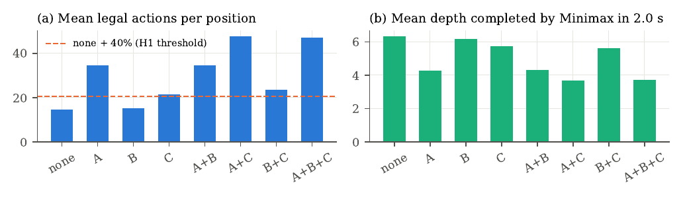
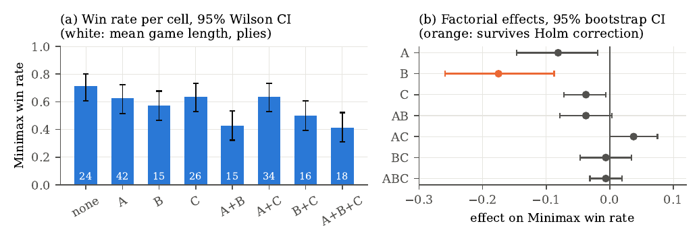
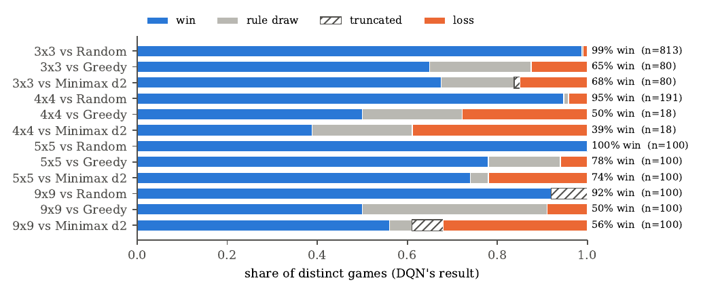
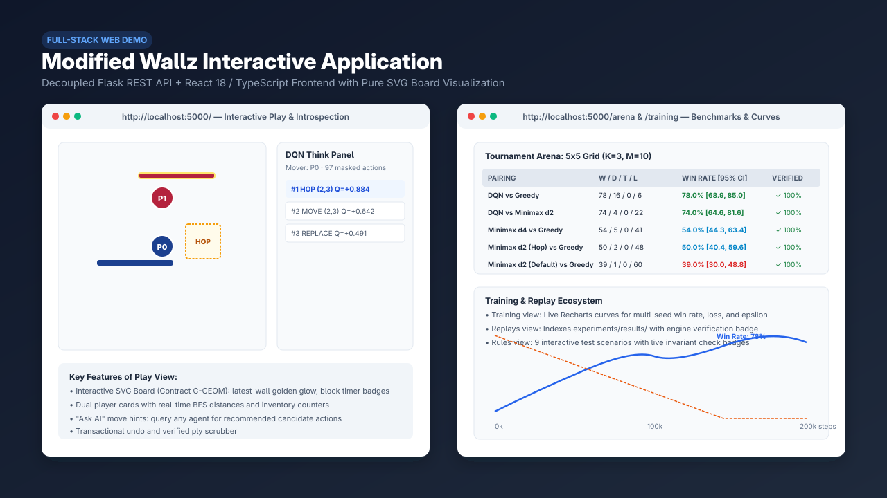
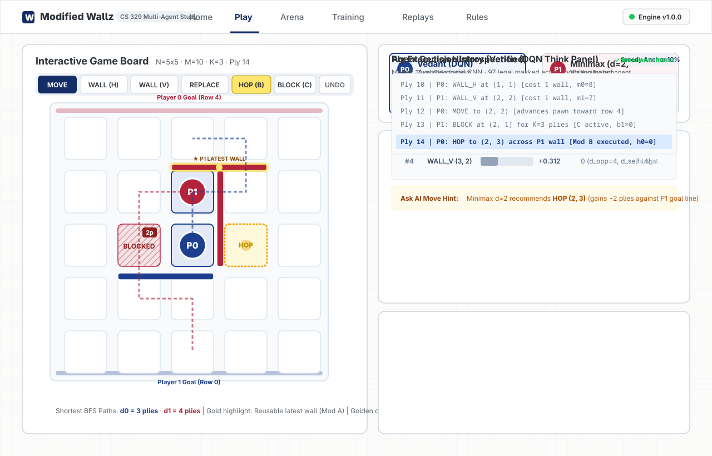
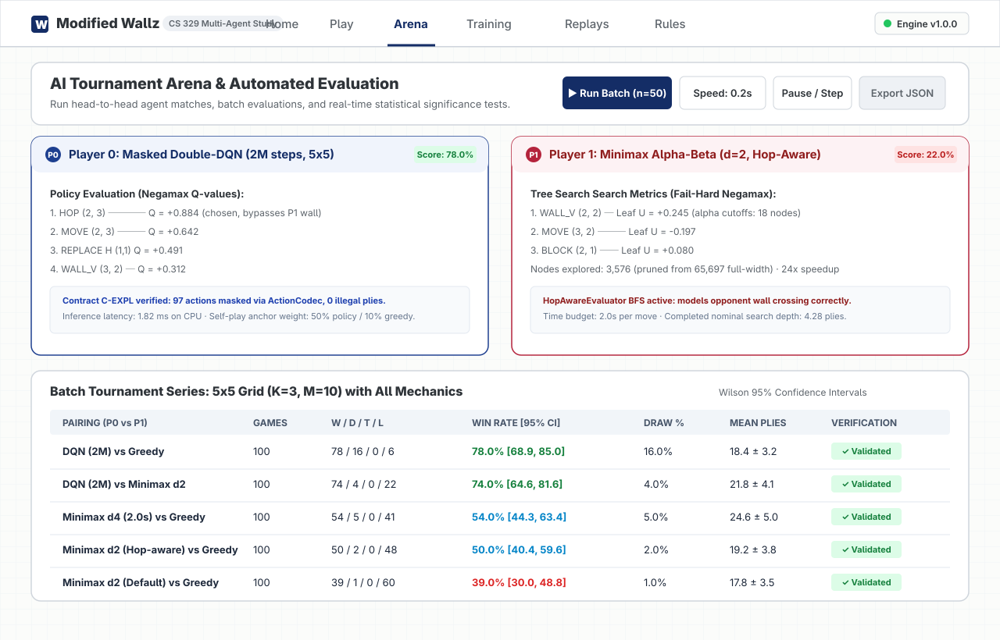
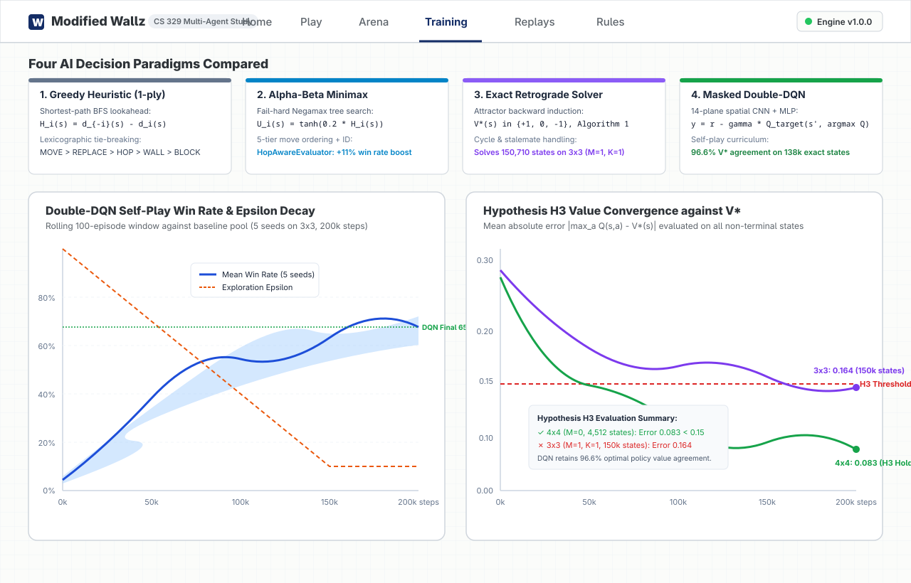
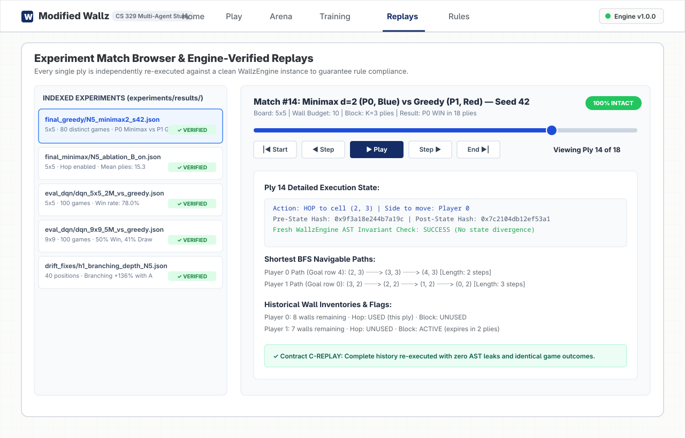
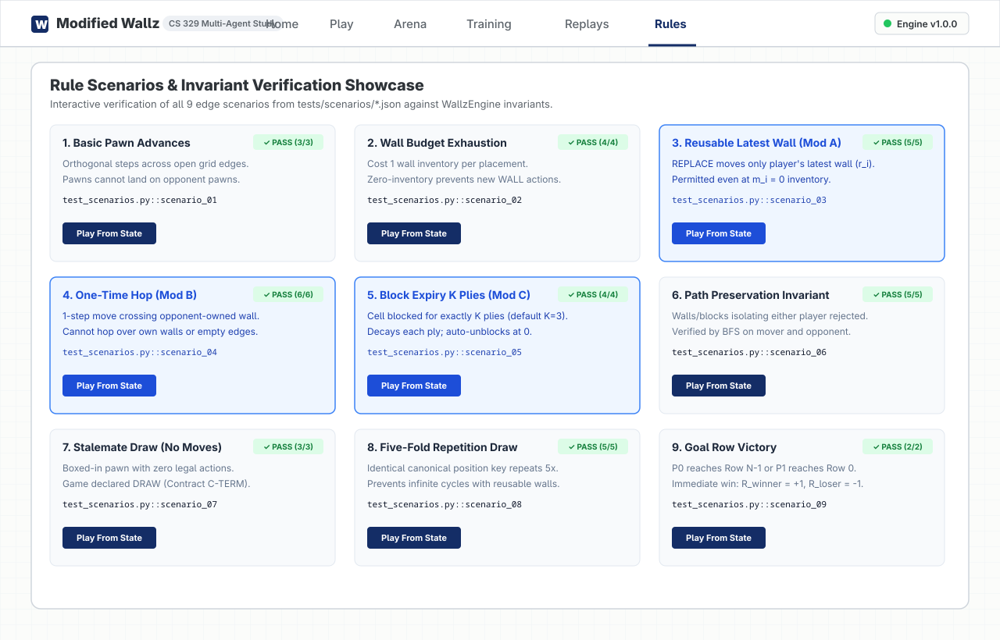

# Modified Wallz — Multi-Agent Spatial Decision-Making Study

[](https://www.python.org/)
[](LICENSE)
[](tests/)
[](https://github.com/vedantb7/FAI_project.git)

Course project for **"Multi-Agent Reinforcement Learning for Adversarial Spatial Decision-Making with Temporal Constraints"**  
*CS 329: Foundations of AI / Multi-Agent Systems, Indian Institute of Technology Gandhinagar (Semester 5).*

Repository URL: **[https://github.com/vedantb7/FAI_project.git](https://github.com/vedantb7/FAI_project.git)**

---

## 1. Project Overview & Accomplishments

Modified Wallz investigates adversarial decision-making, game-theoretic optimality, and reinforcement learning in a constrained spatial environment featuring reversible resources and temporal dynamics. The project delivers a fully verified end-to-end framework:

1. **Canonical Game Engine (`wallz_engine.py`)**:
   - High-performance, zero-sum, two-player adversarial grid race implementing Quoridor with three novel mechanics: **Reusable Walls (Modification A)**, **One-Time Hop (Modification B)**, and **Temporary Cell Blocks (Modification C)**.
   - Enforces strict breadth-first search (BFS) path-preservation invariants, transactional state transitions, immutable canonical position hashing, and 5-fold repetition draw detection.
   - Architecturally guarded as the single source of truth across all AI agents and UI layers via AST and regex validation (`tests/test_single_source.py`).
   - Verified through 454 automated unit/integration tests and an independent fuzzing pass of 10,938 random plies and 3,235 hop-biased plies with zero invariant failures.

2. **Four AI Decision Paradigms**:
   - **Tier 1 — Greedy Heuristic (`agents/greedy.py`)**: 1-ply BFS shortest-path lookahead ranking actions by relative distance differential $H_i(s) = d_{-i}(s) - d_i(s)$ with transparent category priority ordering and instant win-at-once execution.
   - **Tier 2 — Adversarial Minimax (`agents/minimax.py`)**: Negamax tree search with fail-hard Alpha-Beta pruning, 5-tier move ordering (PV move, goal progress, path-cutting walls, blocks, history heuristic), iterative deepening under a 2.0s move budget, and a monotone bounded leaf evaluator $U_i(s) = \tanh(0.2 \cdot H_i(s))$. Includes the specialized **HopAwareEvaluator** that models opponent wall jumps via augmented state BFS.
   - **Tier 3 — Exact Retrograde Solver (`evaluation/retrograde.py`)**: Provably optimal attractor backward induction with cyclic degree propagation on state transition graphs (Algorithm 1 in the report). Solves cyclic miniature configurations up to 462,606 states, computing exact game values $V^* \in \{+1.0, 0.0, -1.0\}$ and shortest distance-to-terminal ranks.
   - **Tier 4 — Masked Negamax Double-DQN (`agents/dqn/`)**: Deep Q-Network utilizing a 14-plane mover-perspective spatial tensor ($14 \times N \times N$), exact legal-action masking via `ActionCodec` (audited over 5.95M actions with 0 illegal plies), horizontal mirror data augmentation, and self-play curriculum with historical snapshot pools.

3. **Rigorous Empirical & Scientific Analysis**:
   - Formally tested hypotheses H1–H4 and research questions RQ1–RQ3 across board dimensions $N \in \{3, 4, 5, 7, 9\}$.
   - Executed a complete $2^3$ paired factorial ablation (640 distinct games) proving the singular statistical significance of Modification B (Hop) after Holm-Bonferroni correction.
   - Ground-truth validation: Double-DQN achieves **96.0%–96.6% value agreement** and **97.7%–97.9% sign agreement** against exact retrograde solutions over all 138,646 non-terminal states of $3\times3$ ($M=1, K=1$).

4. **Interactive Full-Stack Web Application (`web/`)**:
   - Completely decoupled architecture featuring a Flask REST API backend and a modern React 18 / TypeScript frontend rendered with pure SVG (Contract C-GEOM).
   - 5 dedicated views: **Play** (interactive human vs AI with "Ask AI" move hints and think panels), **Arena** (automated tournaments with real-time Wilson 95% CIs), **Training** (live Recharts learning curves and architecture diagrams), **Replays** (engine-verified playback of committed match logs), and **Rules** (live scenario verifier for 9 edge cases).

---

## 2. Game Rules & Mechanics

Modified Wallz is played on an $N \times N$ grid ($N \ge 3$, default $N = 9$; benchmarked on $N \in \{3, 4, 5, 7, 9\}$).  
Player 0 (Blue) starts at `(0, floor(N/2))` racing to goal row $N-1$; Player 1 (Red) starts at `(N-1, floor(N/2))` racing to goal row 0.

| Mechanic | Action | Description | Constraints & Invariants |
|---|---|---|---|
| **Base Move** | `MOVE (r, c)` | Advance pawn 1 step orthogonally | Cannot cross active walls, land on opponent pawn, or enter blocked cells. |
| **Modification A: Reusable Walls** | `WALL (r, c, orient)`<br>`REPLACE (r, c, orient)` | Place new 2-cell wall ($m_i \to m_i - 1$) or reposition latest wall ($m_i$ unchanged) | $M$ initial inventory (`rules['M']`, default 10). `REPLACE` repositions only the player's single most recently placed wall ($r_i$), costs 0 inventory, and is permitted at 0 inventory. |
| **Modification B: One-Time Hop** | `HOP (r, c)` | Step into adjacent cell across a wall placed by the opponent | Single-use ability ($h_i \in \{0, 1\}$). Target must be orthogonally adjacent and across an opponent's wall. Cannot hop over own walls, open edges, pawns, or blocked cells. |
| **Modification C: Temporary Block** | `BLOCK (r, c)` | Block an empty cell for exactly $K$ plies (`rules['K']`, default 3) | Single-use ability ($b_i \in \{0, 1\}$). Impassable for pawns and path checks. Decays each ply; automatically unblocks when timer hits 0. |

- **Path-Preservation Invariant**: Every action must leave at least one unblocked BFS path for **both** players to their respective goal rows. Any action isolating either player is illegal and rejected transactionally.
- **Game Termination**:
  - **Goal Victory**: Active pawn reaches its target goal row ($R_i = +1, R_{-i} = -1$).
  - **Stalemate Draw**: A player to move has no legal actions (boxed in by walls/blocks/pawns).
  - **5-Fold Repetition Draw**: The identical canonical position key occurs 5 times in the game history.
  - **Truncation**: Matches reaching the 200-ply match runner cap are recorded as `truncated`, distinct from rule draws.

Full specification: [`docs/game_rules.md`](docs/game_rules.md). Rule freeze report: [`docs/reports/stage1_engine_freeze.md`](docs/reports/stage1_engine_freeze.md).

---

## 3. Empirical Results & Visual Findings

### 3.1 Search Complexity & Branching Expansion (Hypothesis H1)

Reusable walls (Modification A) and temporary blocks (Modification C) substantially expand the branching factor, reducing the depth completed by Minimax under a fixed 2.0s time limit:



- **Reusable walls (A)** raise mean legal actions from 14.7 to 34.5 (**$+136\%$**), reducing completed search depth from 6.35 to 4.28 plies under a 2.0s move budget.
- **Temporary blocks (C)** raise mean legal actions to 21.3 (**$+46\%$**), reducing search depth by 0.6 plies.
- **Modification B (Hop)** causes negligible branching change ($+3\%$).
- **Hypothesis H1 is strongly confirmed** for both A and C (well exceeding the $+40\%$ threshold).

---

### 3.2 $2^3$ Factorial Ablation of Mechanics

A complete paired factorial ablation playing Minimax (depth 2) vs Greedy on $5\times5$ across all 8 rule configurations (80 games per cell from 40 distinct 4-ply openings in both seats, 640 total games):



- **Only Modification B (Hop) exhibits a statistically significant effect** on match outcomes after Holm-Bonferroni correction ($\Delta \text{win} = -0.175$, $95\%$ CI $[-0.259, -0.088]$, decreases draws by $0.122$, and shortens games by $15.4$ plies).
- Standard heuristic distance underestimates positions when the opponent retains a hop; our **HopAwareEvaluator restores Minimax win rate from 39% to 50%** against Greedy (+11 percentage points).
- **Hypothesis H4 is refuted**: games with all mechanics average 18.2 plies vs 35.1 plies predicted additively; the hop cuts through walls, making spatial modifications sub-additive.

---

### 3.3 DQN Cross-Board Scaling & Exact Value Convergence

Double-DQN was evaluated across board sizes ($3\times3, 4\times4, 5\times5, 9\times9$) against baseline agents and exact retrograde ground truth:

| Board Size | Pairings & Opponents | Games | Win % [95% Wilson] | Draw % | Truncated % | Notes |
|---|---|---|---|---|---|---|
| **$3\times3$** ($M=1, K=1$) | DQN vs Greedy (5 seeds) | 80 | **65.0%** [54.0, 74.6] | 22.5% | 0.0% | $V^*$ agreement: 96.0%–96.6% across 138k states |
| **$5\times5$** ($M=10, K=3$) | DQN (2M steps) vs Greedy | 100 | **78.0%** [68.9, 85.0] | 16.0% | 0.0% | Loss rate only 6.0% |
| **$5\times5$** ($M=10, K=3$) | DQN (2M steps) vs Minimax d2 | 100 | **74.0%** [64.6, 81.6] | 4.0% | 0.0% | Dominates depth-2 heuristic search |
| **$9\times9$** ($M=10, K=3$) | DQN (5M steps) vs Greedy | 100 | **50.0%** [40.4, 59.6] | 41.0% | 0.0% | Sparse rewards on large grid; high draw rate |
| **$9\times9$** ($M=10, K=3$) | DQN (5M steps) vs Minimax d2 | 100 | **56.0%** [46.2, 65.3] | 5.0% | 7.0% | Outperforms Minimax with 7% truncations |



- **Hypothesis H3 (Value Convergence)**: Checkpoint evaluation against exact retrograde induction shows mean value error $|\max_a Q(s, a) - V^*(s)|$ drops to **0.083** on $4\times4$ ($M=0$, 4,512 states), confirming H3 (< 0.15). On $3\times3$ ($M=1, K=1$, 150,710 states), value error steadily declines to 0.164–0.190 after 200k steps.
- **Hypothesis H2 is refuted**: heuristic warm-up yielded higher value error (0.225) compared to pure self-play (0.168), showing that unconstrained self-play explores game-theoretic equilibria more effectively than bootstrapping from heuristic bias.

---

## 4. Interactive Full-Stack Web Application

The repository includes a modern, full-stack web application designed for interactive play, automated head-to-head benchmarking, live training telemetry, and engine verification:



### Primary Web Views

| View | Route | Key Features & Architecture | Screenshot |
|---|---|---|---|
| **Play** | `/` | Interactive SVG board (Contract C-GEOM), gold glow highlighting reusable latest walls, hatched block cells with countdown timers, dynamic BFS path polylines, player cards with wall counters, transactional undo, AI think panels, and "Ask AI" move hints. |  |
| **Arena** | `/arena` | Automated head-to-head AI tournament runner, speed slider (0.1s to 1.5s), dual side-by-side think panels, batch tournaments ($n \in \{6, 10, 20, 50\}$), and real-time Wilson 95% confidence intervals. |  |
| **Training** | `/training` | Comparative decision paradigm cards (Greedy, Minimax, Exact, DQN), interactive Double-DQN training architecture diagram, and multi-seed Recharts learning curves (win rate, TD-loss, epsilon decay). |  |
| **Replays** | `/replays` | Experiment match browser indexing `experiments/results/`, timeline scrubber, step controls, and canonical engine verification badge (every single ply verified with fresh `WallzEngine`). |  |
| **Rules** | `/rules` | 9 interactive rule scenarios (`tests/scenarios/*.json`) with live invariant check badges (green ✓ / red ✗), "Play From This State" session launch, and embedded official specification. |  |

Detailed user manual and REST API specification: [`docs/web_demo.md`](docs/web_demo.md).

---

## 5. Setup & Installation

### Prerequisites
- Python $\ge 3.10$ (tested on 3.12)
- Node.js $\ge 20$ and npm $\ge 10$ (for frontend compilation)

### Clone & Python Environment Setup
```bash
# Clone the repository
git clone https://github.com/vedantb7/FAI_project.git
cd FAI_project

# Create and activate virtual environment
python -m venv .venv
source .venv/bin/activate       # On Windows: .venv\Scripts\activate

# Install development dependencies (PyTorch, NumPy, Flask, Hypothesis, Pytest)
pip install -r requirements-dev.txt
```

### Running the Test Suite
```bash
# Verify AST single-source architectural guards (no rule duplicates)
python -m pytest tests/test_single_source.py -v

# Run the complete test suite (454 tests across engine, agents, and scenarios)
python -m pytest -q

# Run specific mechanic unit tests
python -m pytest tests/test_hop.py -q
python -m pytest tests/test_scenarios.py -q
```

---

## 6. Execution Guide

### Running Matches via CLI
```bash
# Minimax (depth 2) vs Greedy on 5x5 board
python run_match.py --p0 minimax --p1 greedy --depth 2 --board-size 5 --seed 42

# Minimax with HopAwareEvaluator vs Greedy
python run_match.py --p0 minimax:depth=2,eval=hop --p1 greedy --board-size 5 --seed 42

# Double-DQN checkpoint vs Greedy on 5x5 board
python run_match.py --p0 dqn:path=checkpoints/release/dqn_5x5/model.pt --p1 greedy --board-size 5 --seed 42
```

### Launching the Web Demo

#### Production Mode (Unified Single Process — Recommended)
```bash
# 1. Build the React frontend distribution bundle
npm --prefix web/frontend ci
npm --prefix web/frontend run build

# 2. Launch the unified Flask server (serves REST API and compiled SPA)
python -m web.backend.app --port 5000
```
Open **`http://localhost:5000`** in your web browser.

#### Development Mode (Hot Reloading)
```bash
# Terminal 1: Flask REST API backend
python -m web.backend.app --port 5000 --debug

# Terminal 2: Vite development server (proxies API requests to port 5000)
npm --prefix web/frontend run dev
```
Open **`http://localhost:5173`**.

#### Docker Container Deployment
```bash
docker build -t wallz-demo .
docker run --rm -p 5000:5000 wallz-demo
```

### Reproducing Research Experiments & Benchmarks
```bash
# Hypothesis H1: Branching factor and completed search depth
python scripts/h1_branching_depth.py --positions 40 --out experiments/results/drift_fixes/h1_branching_depth_N5.json

# Hypothesis H3: DQN checkpoint value error convergence against exact solves
python scripts/h3_convergence.py

# Final Greedy baseline tournament campaign
python scripts/final_greedy.py run --board N5 --pairing minimax2

# Run full 2^3 factorial ablation study
python scripts/run_experiments.py ablation --x minimax:depth=2 --y greedy -N 5 -K 3 -M 10 --distinct-openings 40 --opening-plies 4 --out-dir experiments/results/ablation_5x5_k3

# Sequential Double-DQN training pipeline across all board sizes
scripts/train_dqn_all.sh
```

---

## 7. Repository Layout

```text
├── wallz_engine.py          # Canonical rule engine: BFS pathing, legal moves, state hashing
├── src/modified_wallz/      # Board geometry, action codec, Gym-style environment wrapper
├── agents/                  # AI Decision Models
│   ├── greedy.py            # Tier 1: 1-ply shortest-path BFS heuristic with score_actions
│   ├── minimax.py           # Tier 2: Alpha-Beta Negamax, move ordering, HopAwareEvaluator
│   ├── evaluation_fn.py     # Monotone leaf evaluation functions
│   ├── exact_solver.py      # Tier 3: Backward induction wrapper with cycle handling
│   └── dqn/                 # Tier 4: Masked Double-DQN, 14-plane tensor, self-play pipeline
├── evaluation/              # Tournament runner, metrics, state-graph builder, ablation
├── scripts/                 # Benchmark runners and experiment entry points
├── experiments/results/     # Committed experimental evidence (final_* folders hold final data)
├── web/
│   ├── backend/             # Flask REST API, session management, introspectors (C-EXPL)
│   └── frontend/            # React 18 + TypeScript presentation layer (pure SVG rendering)
├── report/
│   ├── final_report/        # Final manuscript source (final_report.tex), PDF and figures
│   │   └── figures/         # branching, ablation, dqn_boards, convergence (PDF & PNG)
│   └── project_proposal_report/ # Submission report (final_report.tex <=8 pages) & figures
├── tests/                   # 454 unit, integration, invariant, scenario, and AST single-source tests
└── docs/                    # Game rules, architecture, setup, web demo guide, stage reports
    └── assets/screenshots/  # High-resolution screenshots of all 5 web demo interfaces
```

---

## 8. Team Contributions

| Member | Assigned Tasks | Fulfillment Status |
|---|---|---|
| **Vedant Bondekar** | Minimax search with Alpha-Beta pruning, leaf evaluation $U_i(s)$, 5-tier move ordering, iterative deepening; validation on final rules; hop-aware evaluator (`HopAwareEvaluator`). | **Fulfilled (Yes)** |
| **Abhishek Tagalpallewar** | Core game engine and legal-action generator (`wallz_engine.py`), Greedy heuristic baseline, rule freeze and test suite, full-stack interactive web application (Play, Arena, Replays). | **Fulfilled (Yes)** |
| **Chaitanya Chaudhary** | Match runner and logging pipeline, state-graph builder, exact retrograde solver and validation, agreement metrics, $2^3$ factorial ablation and statistics, multi-seed study, result tables. | **Fulfilled (Yes)**; 4 of 8 $N=4, M=1$ cells capped (reported as UNKNOWN) |
| **Dhruv Meshram** | Masked Double-DQN architecture (CNN+MLP), action codec, self-play training pipeline, replay buffer, training and evaluation on $3\times3$–$9\times9$, H2/H3/RQ1 experimental runs. | **Fulfilled (Yes)**; one seed above $3\times3$ due to compute constraints |

---

## 9. Final Report Deliverables

The consolidated course submission report is maintained under `report/final_report/` and includes all manuscript assets and compilation tools:

- **PDF Report**:
  - `report/final_report/final_report.pdf` (7-page compiled report; course limit is 8 pages)
- **LaTeX Source**:
  - `report/final_report/final_report.tex` (Manuscript source; the only source of the report text)
- **Bibliography**:
  - `report/final_report/references.bib` (Complete BibTeX references)
- **Figures**:
  - `report/final_report/figures/` (All 8 vector PDF and high-resolution raster PNG figures: `branching`, `ablation`, `dqn_boards`, `convergence`)
- **Compilation Tool**:
  - `python3 scripts/compile_report_pdf.py` (Compiles `final_report.tex` with latexmk, pdflatex or Tectonic and fails if the PDF exceeds 8 pages; add `--download-tectonic` on a machine without LaTeX)
- **Proposal Archive**:
  - `report/project_proposal_report/` (Archival project proposal report, checklists, and preliminary draft artifacts)

